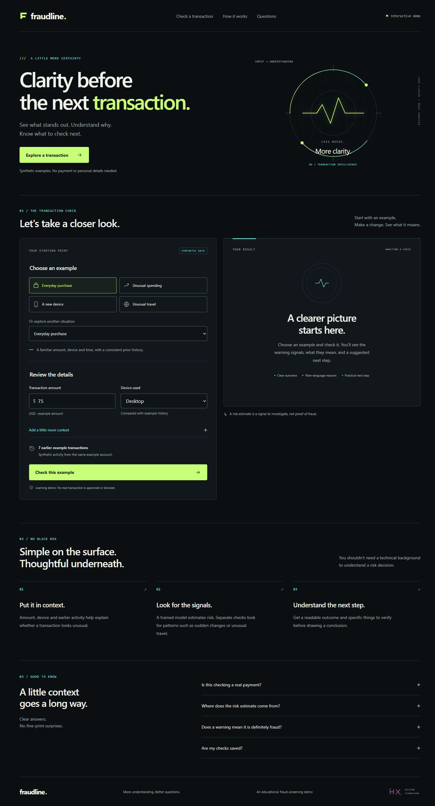
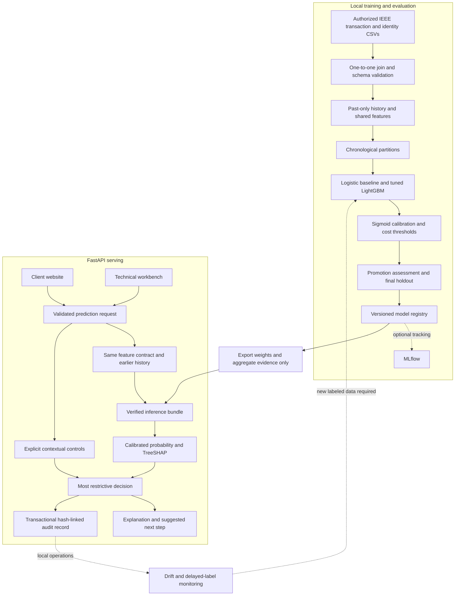
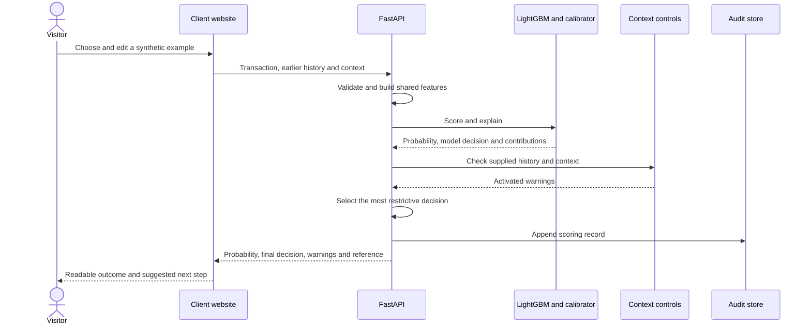
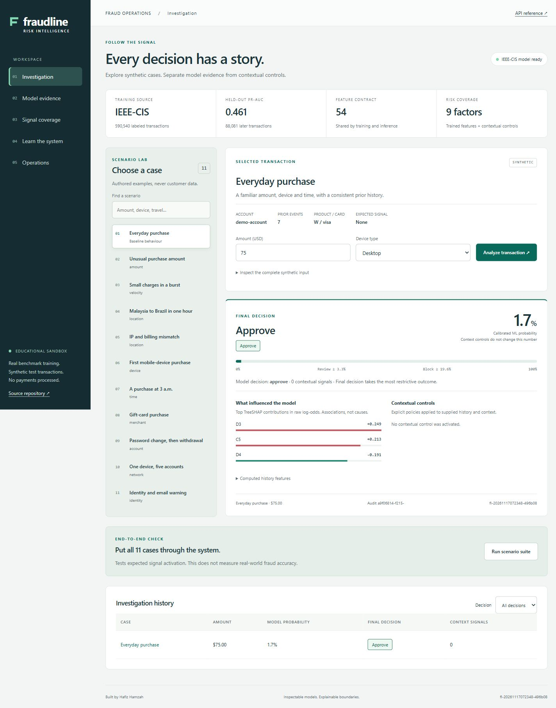
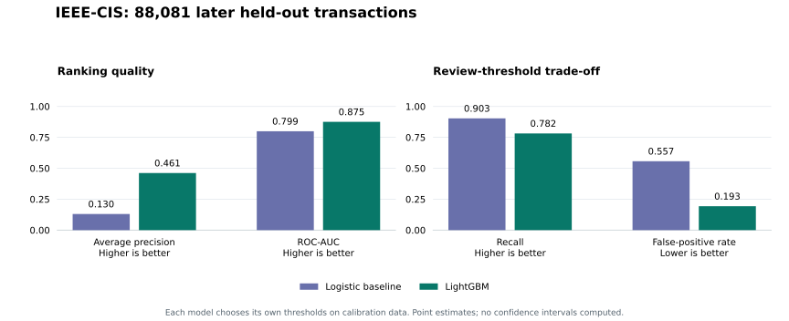

# Fraudline

**An end-to-end fraud detection project: from raw transaction data to an explainable decision.**

[Client demo](https://fraudline.vercel.app) · [Technical workbench](https://fraudline.vercel.app/workbench) · [A–Z learning guide](docs/learning-guide.md) · [GitHub Actions](https://github.com/hafiz-fansuri/fraudline/actions)



## Contents

[Introduction](#introduction) · [Objectives](#objectives) · [System architecture](#system-architecture) · [Methodology](#methodology) · [Demo: how to use](#demo-how-to-use) · [Clone and run locally](#clone-and-run-locally) · [Retrain with IEEE-CIS](#retrain-with-ieee-cis) · [Results](#results) · [Testing and operations](#testing-and-operations) · [Project structure](#project-structure) · [Limitations](#limitations) · [Conclusion](#conclusion)

## Introduction

Fraudline demonstrates how to build, evaluate, serve and monitor a machine-learning fraud detection system. It combines an IEEE-CIS-trained LightGBM model with explicit contextual controls, then explains the resulting decision through two web interfaces:

| Experience | Intended audience | What it provides |
|---|---|---|
| [Client website](https://fraudline.vercel.app) | Nontechnical visitors | Guided examples, editable details, readable outcomes, next steps and downloadable summaries |
| [Technical workbench](https://fraudline.vercel.app/workbench) | Project owner and technical reviewers | Scenario testing, model evidence, feature coverage, monitoring reports and the learning guide |

The experiment uses **590,540 labeled transactions**, including **20,663 fraud cases**, across chronological training and evaluation partitions. The model has **54 input features**. The public website uses **authored synthetic examples**, not real customer payments or copied competition records.

This is an educational portfolio project, not a production banking or payment authorization service. The separate workbench address is not password protection.

## Objectives

1. Build a reproducible pipeline that validates raw data, creates features and records dataset/model lineage.
2. Compare a simple logistic regression baseline with LightGBM on later, held-out transactions.
3. Prevent current, equal-time and future events from leaking into behavioral history features.
4. Separate the learned fraud probability from human-authored contextual policies.
5. Explain decisions with model contributions, readable warnings and suggested next steps.
6. Demonstrate model registration, promotion, rollback, audit records, drift monitoring and delayed-label evaluation.
7. Provide an accessible client experience and a separate technical workbench using free hosting and local training.

## System architecture



**Public Vercel deployment:** interface, verified model inference and temporary audit records. **Optional local stack:** PostgreSQL, MLflow, a monitoring worker, Prometheus and Grafana. Heavy training does not run inside a browser request or on the public serverless function.

| Layer | Technology | Why it is used |
|---|---|---|
| Data processing | pandas, NumPy, Pandera | Table joins, efficient time windows and training-data validation |
| Modeling | LightGBM, scikit-learn, Optuna | Tree boosting, baseline/calibration and bounded hyperparameter search |
| API | FastAPI, Pydantic | Typed payloads, validation and single/batch scoring |
| Frontend | HTML, CSS, JavaScript | Two responsive interfaces without an additional framework/build system |
| Storage | SQLAlchemy, SQLite / PostgreSQL | Transactional audit events and delayed labels |
| Lifecycle | Native model bundles, JSON registry, optional MLflow/DVC | Reproducibility, evidence, promotion and rollback |
| Monitoring | Evidently, Prometheus, Grafana | Distribution checks, service metrics and local dashboards |
| Delivery | Docker Compose, GitHub Actions, Vercel | Local operations, automated checks and public inference hosting |

## Methodology

### 1. Import and validate the data

Join `train_transaction.csv` and `train_identity.csv` on `TransactionID`, enforcing a one-to-one relationship. Preserve transactions with missing identity data and represent the missingness explicitly. Validate IDs, types, supported categories and numeric bounds before preparing the dataset.

Dataset SHA-256 fingerprints, row counts, fraud prevalence and source information are saved for traceability. Raw CSVs and prepared/reference rows remain local and are excluded from Git and deployment uploads. The competition test files have no labels, so they are not used to claim measured accuracy.

### 2. Engineer behavioral features

The shared feature contract includes amount/distance transformations, cyclic relative time, card/product categories, device type, email-domain comparisons, anonymized C/D/M fields and **11 history features**. These include transaction counts over one hour/day/week, small-charge bursts, amount ratio/z-score, device-type novelty and unusual relative hours.

A hashed card/address composite groups related events; it is a proxy, not a verified customer account. Each history calculation uses **strictly earlier timestamps**. The current event, equal-time peers and future events are excluded. Fraud labels never enter the history windows.

An available feature is not necessarily used by the fitted trees. For example, the small-charge input has zero split gain in this run; its explicit card-testing policy remains a separate control.

### 3. Split chronologically, train and calibrate


| Interval | Rows | Purpose |
|---|---:|---|
| Training | 325,908 | Fit the logistic baseline and LightGBM; tune within this interval |
| Calibration | 88,538 | Fit sigmoid calibration and select review/block thresholds |
| Promotion | 88,013 | Assess the candidate against an existing champion, when present |
| Final test | 88,081 | Report later held-out performance without fitting/tuning on its labels |

Six seeded Optuna trials use an internal chronological split **inside the training interval**. The selected IEEE model uses 300 trees, 15 leaves and L2 regularization of approximately 3.621. A sigmoid calibrator maps raw tree scores to probabilities on the separate calibration interval.

Each model chooses its own policy thresholds on calibration data. The illustrative cost assumptions are a $3 review, 20% missed fraudulent value after review, and a $15 false block. They are not measured business costs or actual savings. Calibration and threshold selection share an interval; the later final test provides a separate assessment.

The actual learning code is [`fraudline/pipeline.py`, `_train()`](fraudline/pipeline.py). Look for `LGBMClassifier(...).fit(x, y)`.

### 4. Add contextual controls without changing the probability

| Factor | Learned inputs / proxies | Additional explicit checks |
|---|---|---|
| Amount anomalies | Amount, historical ratio/z-score, small-charge count | Large deviations and repeated small charges |
| Velocity | Prior hour/day/week transaction counts | High transaction rate and supplied login failures |
| Location | Anonymized distance/region proxies | Supplied country mismatch and implausible coordinate travel |
| Device changes | Device type and type novelty | New supplied physical device and device sharing |
| Time patterns | Relative cyclic time and unseen-hour history | Activity at an unusual relative hour |
| Merchant risk | Product proxy, not merchant category | Supplied gift-card, crypto or gambling category |
| Account behavior | No password/payee events in IEEE | Recent password change; new payee plus withdrawal |
| Network links | No trained fraud-ring graph | Distinct accounts sharing a supplied device |
| Identity mismatches | Domains, identity availability and anonymized matches | Supplied identity mismatch/disposable-email flags |

GPS travel, passwords, payees, merchant categories and verified identity flags are **not learned from IEEE**. They are separately labeled policies applied to supplied context. The network check is a simple shared-device relationship count, not a validated fraud-ring model.

### 5. Score, explain and record the result



A contextual check can escalate an approval to review or block, but **does not alter the calibrated probability**. A model block cannot be downgraded by benign context. TreeSHAP contributions explain model associations in raw log-odds, not causal reasons or percentage-point effects.

## Demo: how to use

### Client website

Open **[fraudline.vercel.app](https://fraudline.vercel.app)**. No account or payment information is required.

1. Select **Explore a transaction**.
2. Choose an everyday purchase, unusual spending, a new device or unusual travel. The selector also exposes all eleven examples.
3. Review the amount/device. Optionally add purchase or account context.
4. Select **Check this example**.
5. Read the suggested outcome, model estimate, warning signals and next step.
6. Use **Save this summary** to download a text receipt, or reopen one of the three recent checks.

Editing details clears the old result. Recent checks last only in browser memory and disappear on reload. The dark, minimal client design uses lime/cyan accents and a small magenta **HX** footer signature.

### Technical workbench

Open **[fraudline.vercel.app/workbench](https://fraudline.vercel.app/workbench)** to run the eleven-scenario suite, inspect individual model/policy decisions, compare evaluation metrics, review nine-factor coverage, open the learning guide and inspect operations reports.

<details>
<summary>View the technical workbench</summary>



</details>

### A useful example

The synthetic Malaysia-to-Brazil scenario produces a model probability of approximately **1.9%** and an initial model approval. Its supplied travel history triggers an implausible-travel control, so the final decision becomes **block / pause and verify**. The probability stays at 1.9%. This demonstrates the distinction between a statistical estimate and a policy action—not that a real fraudulent payment was detected.

## Clone and run locally

### Prerequisites

- Git.
- Python **3.11–3.13** and [uv](https://docs.astral.sh/uv/).
- No Kaggle download, paid API key, Docker or model training is needed for the bundled-model quick start.

Windows local execution and Linux CI have been checked. Linux installations may need the system OpenMP package `libgomp1` if LightGBM reports a missing native library; macOS setup has not been verified.

### 1. Clone the repository and install the locked dependencies

```sh
git clone https://github.com/hafiz-fansuri/fraudline.git
cd fraudline
uv sync --frozen
```

### 2. Point the server at the included IEEE model

**Windows PowerShell:**

```powershell
$env:FRAUDLINE_ARTIFACTS = (Resolve-Path .\demo-bundle).Path
uv run uvicorn fraudline.api:app --host 127.0.0.1 --port 8012
```

**Linux / Bash:**

```bash
FRAUDLINE_ARTIFACTS="$PWD/demo-bundle" uv run uvicorn fraudline.api:app --host 127.0.0.1 --port 8012
```

Open the [local client website](http://127.0.0.1:8012) or [local workbench](http://127.0.0.1:8012/workbench). Check [readiness](http://127.0.0.1:8012/ready) to confirm the loaded model. Stop the server with **Ctrl+C**.

The exported `demo-bundle/` already contains verified model weights, calibration, thresholds and aggregate evaluation evidence. Serving it does not require access to raw training records. Local audit events are written under ignored `runtime/` storage.

### 3. Optional: install development and operations tools

```sh
uv sync --frozen --extra dev --extra ops
```

These extras add testing, training, tuning, tracking and monitoring tools; they are not needed for the minimal inference quick start.

## Retrain with IEEE-CIS

Obtain the original competition data through [Kaggle](https://www.kaggle.com/competitions/ieee-fraud-detection) under its terms. Put `train_transaction.csv` and `train_identity.csv` in an accessible folder. The raw files are not included in this repository.

Stop the local server before switching artifact environments. Use a separate `runs/ieee` workspace so synthetic and real-data registries do not mix. **Clear `FRAUDLINE_ARTIFACTS` from the quick start before training**; otherwise that override would direct writes into the serving export.

**Windows PowerShell**—adjust the dataset path:

```powershell
uv sync --frozen --extra dev --extra ops
Remove-Item Env:FRAUDLINE_ARTIFACTS -ErrorAction SilentlyContinue
$env:FRAUDLINE_HOME = Join-Path (Get-Location) 'runs/ieee'

uv run python -m fraudline.pipeline prepare --ieee 'C:\path\to\ieee-fraud-detection'
uv run python -m fraudline.pipeline train --tune
uv run python -m scripts.test_scenarios
uv run python -m fraudline.monitor --demo
uv run python -m scripts.export_demo

uv run uvicorn fraudline.api:app --host 127.0.0.1 --port 8012
```

**Linux / Bash:**

```bash
uv sync --frozen --extra dev --extra ops
unset FRAUDLINE_ARTIFACTS
export FRAUDLINE_HOME="$PWD/runs/ieee"

uv run python -m fraudline.pipeline prepare --ieee /path/to/ieee-fraud-detection
uv run python -m fraudline.pipeline train --tune
uv run python -m scripts.test_scenarios
uv run python -m fraudline.monitor --demo
uv run python -m scripts.export_demo

uv run uvicorn fraudline.api:app --host 127.0.0.1 --port 8012
```

`prepare` saves validated Parquet data and lineage locally. `train` fits, calibrates, evaluates and updates the run registry. `test_scenarios` checks the real API path with synthetic cases. `monitor --demo` generates a labeled synthetic drift exercise; it does not retrain. `export_demo` copies only model weights, metadata and aggregate evidence to `demo-bundle/`, never raw/reference rows.

Restart the API after promotion or rollback: it pins a verified model at startup. Do not run synthetic preparation in the IEEE run directory or repeatedly tune against the published final holdout.

## Results

Results below come from model **`fl-20261117072348-496b08`**, evaluated on **88,081 later held-out transactions**. They are not scores measured from the synthetic website examples.



| Measure | Logistic baseline | LightGBM | Interpretation |
|---|---:|---:|---|
| Average precision / PR-AUC ↑ | 0.1301 | **0.4614** | Better concentration of fraud near the top of the ranking |
| ROC-AUC ↑ | 0.7993 | **0.8754** | Better separation of fraudulent and legitimate events |
| Brier score ↓ | 0.03845 | **0.02429** | Lower mean squared probability error |
| Recall at review threshold ↑ | **90.34%** | 78.17% | Baseline catches more fraud at its own, more permissive policy |
| False-positive rate ↓ | 55.70% | **19.31%** | LightGBM flags fewer legitimate events for review |
| Hypothetical cost / transaction ↓ | 3.2365 | **2.4750** | Lower loss under the illustrative cost assumptions |

**The trade-off matters:** LightGBM improves ranking, probability error and hypothetical cost, but its selected policy has lower recall than the baseline. A **19.3% legitimate false-positive rate is still substantial**. Product W average precision is only **0.0962**, so aggregate results hide a weaker slice. These results do not establish production readiness or actual financial savings.

The IEEE dataset is about 3.5% fraud. An always-approve classifier could look about 96.5% accurate while detecting no fraud, which is why ordinary accuracy is not the headline metric.

### Serving and synthetic checks

| Check | Executed outcome | What it establishes |
|---|---|---|
| Regression suite | **30 tests passed** | API contracts, integrity, audit behavior, temporal isolation and other tested logic |
| Synthetic end-to-end suite | **11/11 expected-factor checks passed** | Serving/control behavior, not classifier accuracy |
| Public API exercise | Baseline approved; travel case paused/blocked; invalid amounts rejected | Hosted scoring and validation work on the checked examples |
| Client UI | Desktop, 375px mobile and landscape checked | Guided flow, recent checks, summary download and responsive layout |
| CI | Lint, tests, bundle/scenario checks, lifecycle smoke run, runtime audit and Docker build | Automated implementation checks |

See [IEEE execution evidence](docs/ieee-verification.md), [client verification](docs/client-experience.md) and the [model card](docs/model-card.md). The [earlier synthetic-stack exercise](docs/verification.md) is historical; its latency/coverage measurements are not measurements of this IEEE model.

## Testing and operations

### Run the checks

```sh
uv sync --frozen --extra dev --extra ops
uv run ruff check fraudline app.py scripts tests
uv run pytest -q
```

To exercise the committed serving bundle with synthetic API cases, use `FRAUDLINE_ARTIFACTS=demo-bundle` for `uv run python -m scripts.test_scenarios`. To regenerate the README charts from committed metadata/evaluation, run:

```sh
uv run --extra ops python -m scripts.plot_readme
```

### Optional full local stack

With Docker running:

```sh
uv run python scripts/up.py
```

The helper creates ignored local credentials and launches PostgreSQL, MLflow, bootstrap training, the API, monitoring, Prometheus and Grafana.

| Service | Local address |
|---|---|
| Client / workbench | [localhost:8013](http://localhost:8013) / [/workbench](http://localhost:8013/workbench) |
| MLflow | [localhost:5013](http://localhost:5013) |
| Prometheus | [localhost:9093](http://localhost:9093) |
| Grafana | [localhost:3013](http://localhost:3013) |

Compose's default mounts/bootstrap use a **separate synthetic lifecycle**, not the published IEEE run. To operate on IEEE locally, adjust its artifact/data mounts to that run first. Do not expose the local stack or its generated `.env` credentials publicly. `docker compose down` preserves volumes; `down -v` removes them.

The monitor distinguishes distribution drift from accuracy: delayed ground-truth labels are needed to measure performance. Retraining requires a new validated labeled dataset and a cooldown; the browser does not trigger it. MLflow tracking is opt-in through `MLFLOW_TRACKING_URI`. DVC stages support the synthetic workflow and are not an automatic reproduction of the executed IEEE experiment.

### Hosting

Vercel loads the included bundle through `app.py`; training stays local. GitHub Actions verifies code, the committed serving bundle and a synthetic lifecycle. Production publishing is explicit via `npx vercel deploy --prod` from a checkout linked to the intended Vercel project, or through an optional configured `VERCEL_DEPLOY_HOOK` after checks. Do not assume the Git integration or hook is connected merely because CI is green.

The compatible OpenMP runtime and its license/notice are under [`native/`](native/NOTICE.md). Vercel audit storage is instance-local `/tmp`, can disappear and is not a shared durable ledger. Continuous monitoring and durable PostgreSQL remain local-stack capabilities.

## Project structure

```text
fraudline/
├── fraudline/
│   ├── data.py            # Import, validation, shared features and time splits
│   ├── history.py         # Past-only behavioral windows
│   ├── pipeline.py        # Actual training, calibration, evaluation and registry
│   ├── model.py           # Verified inference and TreeSHAP contributions
│   ├── signals.py         # Explicit contextual policies and factor coverage
│   ├── scenarios.py       # Authored synthetic cases
│   ├── api.py             # Validated HTTP endpoints and interface routes
│   ├── store.py           # Audit events and delayed labels
│   ├── monitor.py         # Drift/performance reports and guarded retraining
│   └── web/               # Client site, technical workbench and learning guide
├── demo-bundle/           # Public-safe committed model and aggregate evidence
├── scripts/               # Export, scenario checks, charts and local operations
├── tests/                 # Regression tests
├── docs/                  # Learning guide, model card, runbook and evidence
├── infra/                 # Local monitoring/database configuration
├── app.py                 # Vercel entrypoint
├── compose.yaml           # Optional local operations stack
├── pyproject.toml         # Dependencies and optional tool groups
└── uv.lock                # Locked Python dependency resolution
```

## Limitations

- Anonymized IEEE fields and hashed entity proxies have uncertain real authorization-time semantics.
- Public requests supply their own history, capped at 200 events. Real operation needs trusted, complete event-time history; offline and truncated online histories may differ.
- GPS, device IDs, merchant categories, password/payee events and identity flags are supplied context, not connected verification services or learned IEEE evidence.
- Costs and control thresholds are illustrative. Review capacity, customer impact and external-bank performance have not been validated.
- Audit chains provide tamper evidence, not administrator-proof immutability. Public storage is ephemeral, and `/workbench` has no authentication.
- The final test must stop being called untouched if future iterations use its published results to select changes.
- No real payments, production SLA, causal fraud explanations, validated fraud-ring detector or demonstrated financial savings are claimed.

## Conclusion

Fraudline connects data validation, time-aware features, model training, calibration, evaluation and serving in one inspectable project. LightGBM improves ranking quality and reduces false positives relative to the baseline's selected policy, while leaving a meaningful review burden and weaker product slices that require further work.

The client website makes the results easier to understand; the technical workbench exposes the evidence behind them. The next engineering steps would be trusted history retrieval, durable access-controlled storage, stronger external/temporal validation and business-validated review policies—not simply adding more infrastructure.

For the full explanation of the code and design choices, start with the **[A–Z learning guide](docs/learning-guide.md)**, then read the [training source](fraudline/pipeline.py), [runbook](docs/runbook.md) and [model card](docs/model-card.md).
