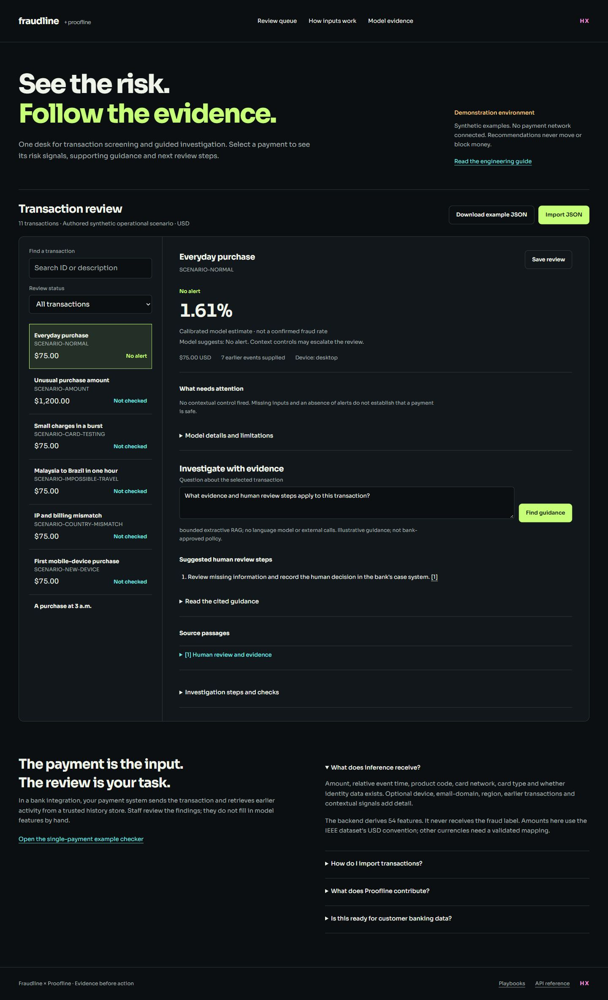
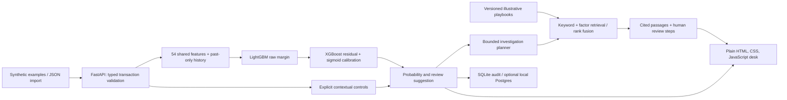
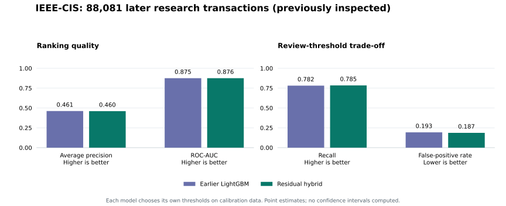
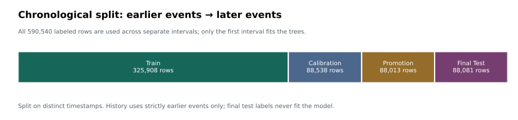

# Fraudline + Proofline

A transaction review desk that brings fraud screening and cited investigation guidance into one app.

**[Open the app](https://fraudline.vercel.app/)** · [Technical workbench](https://fraudline.vercel.app/workbench) · [A–Z learning guide](docs/unified-guide.md) · [Training code](fraudline/hybrid.py)



## Introduction

Financial operations staff need to understand why a payment was flagged and what to check next. This app combines Fraudline's transaction scoring with Proofline's evidence-retrieval patterns. Select a transaction, inspect the model estimate and contextual findings, and retrieve relevant review guidance without switching apps.

This is a public, synthetic-data demonstration intended to explore a banking workflow. It has **no bank connection, account authentication, tenant isolation or authority to move money**. Do not upload customer data. The old client checker remains at `/checker`; the engineering workbench remains at `/workbench`.

## Objectives

- Keep the analyst's job simple: select, understand, investigate and save a review.
- Run the supplied Kaggle LightGBM → XGBoost residual approach outside Kaggle.
- Keep one feature contract for training and single-transaction inference.
- Explain model scores separately from contextual rules and investigation guidance.
- Return inspectable, versioned evidence and abstain when no relevant passage exists.
- Keep the public demo free, without paid AI calls or raw dataset uploads.

## System architecture



| Layer | Choice and reason |
| --- | --- |
| Frontend | HTML, CSS, JavaScript; existing self-hosted Sora and dark/neon HX identity, no frontend framework needed |
| Backend | FastAPI and Pydantic; shared scoring/review API and strict input checks |
| Detection | LightGBM + CPU-only XGBoost; native persisted models and calibrated probability |
| Features | pandas/NumPy; shared 54-feature builder, strictly earlier history |
| Investigation | Local bounded extractive RAG; Proofline-inspired rank fusion, citations and abstention, no external AI call |
| Evidence | Ten original, versioned demo playbooks with SHA-256 provenance; not bank-approved policy |
| Audit | SQLAlchemy SQLite; ephemeral on Vercel, optional local PostgreSQL |
| Testing / CI | pytest, Ruff, GitHub Actions, synthetic scenarios and artifact integrity checks |
| Hosting | Vercel FastAPI; training and optional operations run locally |

Proofline's original Supabase/OpenRouter services and OWASP corpus are **not** called by this unified app. Its AI-security corpus is not a banking policy source. See [integration attribution](docs/PROOFLINE-NOTICE.md).

## What input does inference get?

The model receives a payment record, not a user's question or the fraud label. The backend turns it into 54 numerical features. The question goes only to the evidence retriever; it cannot change the fraud probability.

Minimum request to `/api/review`:

```json
{
  "transaction": {
    "transaction_id": "DEMO-001",
    "amount": 75.0,
    "time_offset": 907200,
    "product": "W",
    "network": "visa",
    "card_type": "debit",
    "identity_present": true
  },
  "question": "What evidence and human review steps apply to this transaction?"
}
```

Required scoring fields: positive amount, nonnegative relative time, IEEE product code (`W/C/R/H/S`), supported card network/type and identity-availability boolean. `transaction_id` is required by the import UI and must be unique in a file. Optional fields include pseudonymous account ID, device type, email domains, regions, distance, up to 200 earlier events, contextual location/authentication signals and 28 whitelisted anonymized C/D/M benchmark fields. Exact types and bounds are in [the API schema](https://fraudline.vercel.app/openapi.json) and [Transaction](fraudline/api.py).

**Production integration:** the bank's backend would populate these inputs and retrieve trusted history. An analyst should not type 54 features. IEEE product codes and C/D/M fields are anonymized competition features, not universal banking fields. Missing values are handled, but that does not establish accuracy for a bank's data. Currency/time-zone conversion and a bank-specific retraining/mapping contract are required before real integration.

## Methodology

1. Merge labeled IEEE transaction and identity files; retain private data locally.
2. Build the existing shared features, with history strictly before each transaction.
3. Split chronologically: 325,908 training; 88,538 calibration; 88,013 promotion/research comparison; 88,081 final research interval.
4. Within training, use three expanding-time folds. Fit LightGBM on the past and generate out-of-fold log-odds for later rows. Equal timestamps never cross fold boundaries; the earliest unscored prefix is excluded from residual fitting.
5. Fit the final LightGBM on the training partition. Fit XGBoost with the out-of-fold log-odds as `base_margin`, as in the supplied residual idea.
6. Fit a sigmoid calibrator and choose review/pause thresholds only on calibration rows. Persist both model stages, feature order, hashes and calibration.
7. Evaluate without fitting on the research intervals. The same intervals were inspected during the earlier project: this is **not a new untouched benchmark**.
8. At inference, apply contextual controls separately; they can escalate a suggestion without changing the model probability.
9. Retrieve relevant playbooks by question keywords and fired control factors. Fuse ranks and return up to five unique playbooks, source passages, review steps and validated citation IDs.

### Changes from the Kaggle notebook

[Portable training](fraudline/hybrid.py) accepts paths and CPU limits. It needs no `/kaggle/input`, GPU, unlabeled competition test set or submission file. It uses 54 serving-compatible features instead of 488 transductive notebook features; train+test aggregates and batch-dependent rank blending are removed. Grouped folds that could train on later timestamps are replaced with expanding-time folds. All serving artifacts are saved. Consequently, the notebook's reported metrics are not comparable evidence for this app.

## Demo: how to use

1. Open the [unified desk](https://fraudline.vercel.app/). Eleven authored synthetic cases are available.
2. Select a transaction. Read the model estimate, suggestion and separate contextual findings.
3. Open **Model details and limitations** to inspect thresholds, model version and audit reference.
4. Ask a review question under **Investigate with evidence**. Read suggested human steps and expand the cited source passages.
5. Use **Save review** to download the assessment and evidence as JSON.
6. Use **Download example JSON**, edit synthetic values, then **Import JSON**. Format: `{"transactions": [...]}`; 1–100 unique transaction IDs, maximum 256 KiB. Import validates and scores records; it does not train the model. Validation scoring also writes audit entries.

The queue and saved UI assessments last only for the current page session. No transaction is blocked, approved at a payment network or submitted to a regulator. Public Vercel audit storage is temporary.

## Clone and run

Windows PowerShell, Python 3.11–3.13 and [uv](https://docs.astral.sh/uv/):

```powershell
git clone https://github.com/hafiz-fansuri/fraudline.git
cd fraudline
uv sync --frozen --extra dev --extra train
$env:FRAUDLINE_ARTIFACTS = (Resolve-Path demo-bundle).Path
uv run uvicorn fraudline.api:app --host 127.0.0.1 --port 8000
```

Open `http://127.0.0.1:8000`. The verified bundle is included; downloading IEEE data is unnecessary for inference. Do not set `VERCEL` locally. The repository contains no provider secret, customer records or raw IEEE CSVs.

### Train outside Kaggle

Download IEEE-CIS data yourself under its competition terms. Keep it outside Git. Prepare a separate private run directory:

```powershell
Remove-Item Env:FRAUDLINE_ARTIFACTS -ErrorAction SilentlyContinue
$env:FRAUDLINE_HOME = Join-Path (Get-Location) 'runs/ieee'
uv run python -m fraudline.pipeline prepare --ieee '..\ieee-fraud-detection'
uv run python -m fraudline.hybrid --data runs/ieee/data/transactions.parquet --output runs/ieee/artifacts/models/my-hybrid --rounds 300 --threads 2
```

The output directory must be new. Training verifies prepared-data lineage and writes `model.txt`, `residual.ubj`, `metadata.json` and `evaluation.json`. **Training happens in `fraudline/hybrid.py`, inside `train()`**. The earlier single-stage pipeline remains in `fraudline/pipeline.py`; it does not train the new hybrid. No automatic replacement of the served champion occurs when running the hybrid training command. Review results and update/export the registry explicitly; see the [learning guide](docs/unified-guide.md).

## Results





Executed local CPU run: `fl-hybrid-20261124-final`, 300 rounds per stage, two threads, 590,540 labeled IEEE rows distributed across the splits above. Trees fit the training partition; they do not fit all 590,540 rows. Published metrics are from 88,081 later rows.

| Measure | Earlier LightGBM | New residual hybrid |
| --- | ---: | ---: |
| Average precision / PR-AUC | 0.46145 | 0.46008 |
| ROC-AUC | 0.87543 | 0.87565 |
| Brier score (lower better) | 0.02429 | 0.02457 |
| Recall at review threshold | 0.78173 | 0.78467 |
| False-positive rate | 0.19307 | 0.18681 |

The hybrid is served to implement the requested model architecture, **not because it proves superior accuracy**. Thresholds differ by calibration. The false-positive burden remains substantial. These are research results on reused, previously inspected intervals, not production savings or proof of readiness.

[Original single-stage charts and historical verification](docs/ieee-verification.md) remain historical evidence. Current machine-readable evaluation is in [the bundle](demo-bundle/models/fl-hybrid-20261124-final/evaluation.json).

## Tests and delivery

```powershell
uv run ruff check fraudline app.py tests scripts
uv run pytest -q
$env:FRAUDLINE_ARTIFACTS = (Resolve-Path demo-bundle).Path
uv run python -m scripts.test_scenarios
```

Tests cover shared features, chronological boundaries, native model integrity, hybrid batch/single parity, contextual controls, audit behavior, cited retrieval, abstention and API rejection of target labels. Eleven synthetic scenarios exercise serving and controls; **they do not measure classifier accuracy**. Citation ID validation does not establish claim support or policy correctness.

GitHub Actions verifies changes to `main`. Vercel is published separately through the CLI unless a deployment hook is configured. The optional local Docker/MLflow/Prometheus/Grafana stack remains documented in [the runbook](docs/runbook.md); it is not continuously running on Vercel.

## Conclusion

The combined app turns a model score into a reviewable workflow: one transaction, clear findings, inspectable guidance and a human next step. It is an educational foundation for a bank-specific system. Operational adoption requires approved policies, trusted history, access controls, durable audit storage, fresh validation and a separately reviewed payment integration.

Learn why each component exists and how to extend it in [the A–Z unified guide](docs/unified-guide.md). Earlier implementation details remain in [the original learning guide](docs/learning-guide.md).
