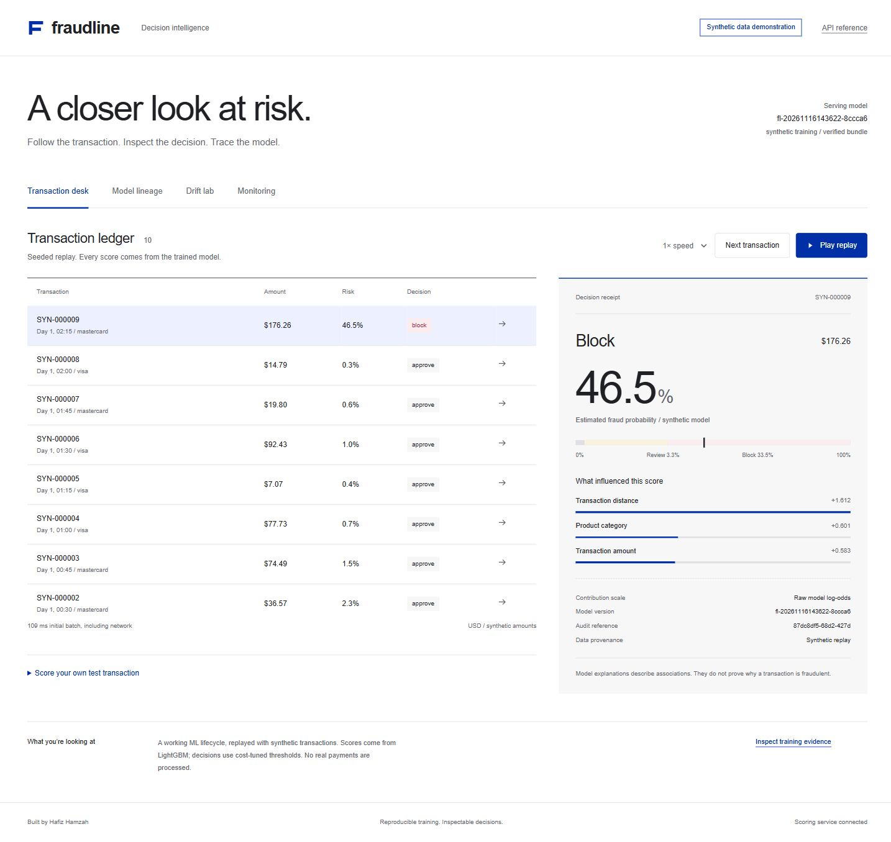
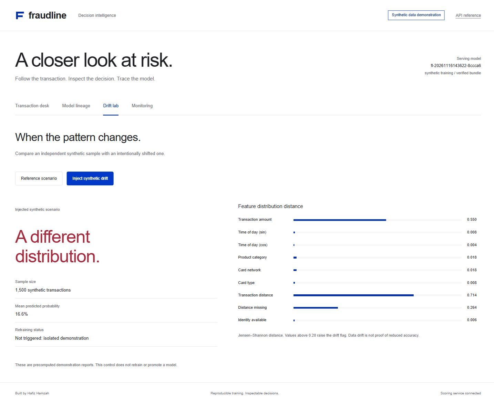

# Fraudline

A fraud detection MLOps project with a transaction investigation desk: real trained-model predictions, calibrated scores, reason contributions, model lineage and an injected drift demonstration.

[Open the Vercel demo](https://fraudline.vercel.app) · [GitHub Actions](https://github.com/hafiz-fansuri/fraudline/actions)

**Current data is synthetic.** IEEE-CIS data has not been supplied. Synthetic metrics demonstrate the pipeline; they do not establish real fraud detection quality. This is a portfolio demonstration, not a banking service.



## Executed verification

The local project has passed 12 tests (71% overall coverage; 90% API and 86% feature/data coverage). The Docker/Postgres path measured warm HTTP p95 at 62.3 ms for 60 requests with four concurrent clients on the documented Windows host. This is a small local benchmark, not a production SLA. See [verification evidence](docs/verification.md).

The complete local stack was started and checked. A synthetic traffic exercise produced 600 audited predictions, 200 delayed labels, an Evidently report and a drift alert. A previous model was served after rollback and the original champion was restored. The scoring application and UI are hosted on Vercel; training and scheduled monitoring remain in the local operations stack.

## Run without Docker

Install Python 3.11–3.13 and [uv](https://docs.astral.sh/uv/). From this directory:

```sh
uv sync --frozen --extra dev --extra ops
uv run python -m fraudline.pipeline demo
uv run python -m fraudline.monitor --demo
uv run uvicorn fraudline.api:app --host 127.0.0.1 --port 8012
```

Open http://127.0.0.1:8012. On this Windows checkout, the installed environment is `.venv\Scripts\python.exe`; use it in place of `uv run python`. No account, API key or payment card is needed for the local demonstration.

## Start the complete local stack

Start Docker Desktop or another Docker daemon first. Then:

```sh
make up
# Windows without make:
python scripts/up.py
```

This generates ignored local passwords and starts Postgres, MLflow, bootstrap training, the API, a five-minute monitor, Prometheus and Grafana. Services bind to loopback. Open the desk on port 8013, MLflow on 5013, Prometheus on 9093 and Grafana on 3013. Grafana username is `admin`; its generated password is in `.env`. Do not expose this development stack directly to the Internet.

## What works

- Joined-data import with one-to-one validation, schema gates, dataset hashes and chronological splits without timestamp overlap.
- Logistic baseline, bounded optional Optuna search, LightGBM, sigmoid calibration, cost-tuned review/block thresholds and product-slice reports.
- Champion/challenger gate and one-command rollback. Model bundles include source/data lineage, feature schema, thresholds and a verified model hash.
- FastAPI single/batch predictions, bounded payloads, strict request contract, process-local rate limit, model version and native LightGBM contributions.
- Transactional hash-linked audit records using SQLite locally or Postgres in Compose. The Compose scoring role cannot update/delete scoring events. This is tamper evidence, not administrator-proof immutable storage.
- Delayed-label import and performance metrics; scheduled drift reports with Evidently HTML, local alerts, optional webhook delivery, and retraining only when newly prepared labeled data is available.
- DVC cached stages, MLflow tracking/registry when configured, Prometheus/Grafana, CI definition, Render deployment blueprint and test suite.
- Responsive investigation UI with seeded replay, manual test scoring, reason contributions, evaluation artifacts, model history, monitoring and computed synthetic drift scenarios.

## Reproduce with DVC

```sh
git init  # only if this directory is not already its own repository
uv run dvc init
uv run dvc repro
```

`dvc.lock` records content hashes after execution. Raw data and local model artifacts stay outside ordinary Git. A local DVC cache is sufficient to replay on this computer; configure an authorized remote before sharing reproducibility across computers. Do not upload competition data into a public remote.

## Train on IEEE-CIS

Download the competition files yourself after accepting the [Kaggle terms](https://www.kaggle.com/competitions/ieee-fraud-detection/rules). Use a separate working directory via `FRAUDLINE_HOME` for IEEE artifacts so synthetic and IEEE model registries are never mixed:

```sh
FRAUDLINE_HOME=/absolute/path/ieee-run uv run python -m fraudline.pipeline prepare --ieee /path/to/csvs
FRAUDLINE_HOME=/absolute/path/ieee-run uv run python -m fraudline.pipeline train --tune
```

PowerShell: set `$env:FRAUDLINE_HOME = 'C:\path\ieee-run'` before the commands. Required files are `train_transaction.csv` and `train_identity.csv`. The first import deliberately uses a compact, stateless subset of shared features. It must not imply all anonymized IEEE fields are available at real authorization time.

## Operations

```sh
uv run pytest --cov=fraudline --cov-report=term-missing
uv run python -m fraudline.benchmark --url http://127.0.0.1:8013
uv run python -m fraudline.monitor
uv run python -m fraudline.pipeline train --tune
uv run python -m fraudline.pipeline rollback
uv run python -m scripts.labels delayed-labels.csv
```

Restart the API after promotion/rollback; it pins a verified bundle at startup. `make rollback` restarts the Compose API automatically. Set `MLFLOW_TRACKING_URI` to log runs and register aliases. Without it, the local JSON bundle registry is authoritative. Do not run multiple independent lifecycle operators against the same workspace.

See [runbook](docs/runbook.md), [model card](docs/model-card.md) and [architecture](docs/architecture.md).



## Free hosted demo

`uv run python -m scripts.export_demo` exports only the synthetic champion into `demo-bundle`. Both Vercel and the Docker image load this same model; neither trains at request time. `app.py` is the Vercel entrypoint and `vercel.json` selects FastAPI. Training-only packages are optional extras, keeping the function small. The bundled OpenMP runtime and its upstream license are documented in `native/NOTICE.md`.

The Vercel application is at https://fraudline.vercel.app. To deploy from a checkout linked to your Vercel account, run `npx vercel deploy --prod`. Git integration can deploy new pushes independently of GitHub CI; require deployment checks if you need a strict verification gate. The workflow also supports an optional `VERCEL_DEPLOY_HOOK` secret for a post-verification deployment.

On Vercel, scoring audit records live in writable `/tmp` storage and are isolated to an instance; they can disappear on restart. No shared durable audit log or scheduled monitoring is claimed for the public demo. Use the local Compose stack for that functionality. Free hosting quotas and cold starts apply.

## Explicit limits

No enterprise feature store, Kubernetes, Kafka or LLM. Past-window card/device history features are deferred until the serving path has durable event-time state and tested ordering semantics. No production payment processing, causal explanations or demonstrated financial savings. An untouched final interval is reported for assessment, never used by the promotion gate; stop using it as a final holdout if you iterate against its published results.
