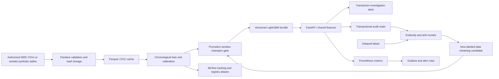

# Architecture

One Python package owns validation, features and scoring. The hosted bundle carries the IEEE-trained model, aggregate evidence, authored synthetic scenarios and UI; source/reference rows are excluded. Past-only history is shared by preparation and request enrichment. Context controls may escalate the decision without changing calibrated probability. Training and monitoring run separately. See the [A–Z guide](learning-guide.md) for coverage and trust boundaries.
