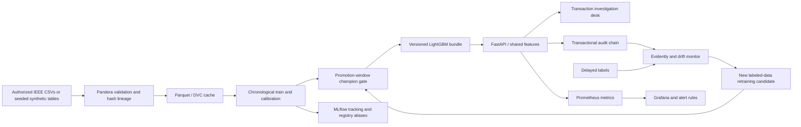

# Architecture

One Python package owns validation, features and scoring. The hosted image carries a synthetic-only export of the model and UI. Training and monitoring run separately. No cloud secret is needed for local execution.
